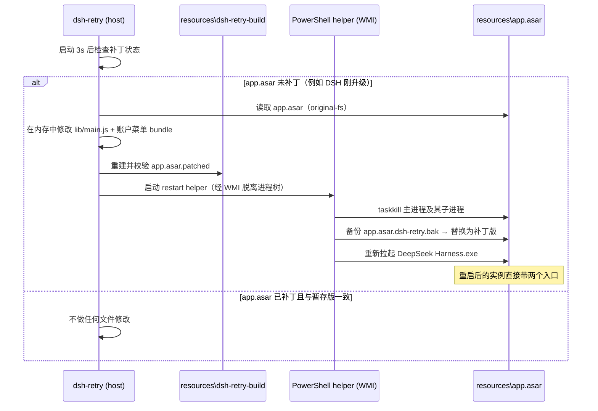

# dsh-retry

**给 DeepSeek Harness 桌面端加一个真正的「重启」入口 —— 托盘菜单、账户菜单，外加侧栏页脚与设置页里的官方入口。原生样式、原生位置。**

[](https://github.com/kouzerror/dsh-retry/actions/workflows/ci.yml)
[](https://github.com/kouzerror/dsh-retry/releases)
[](./LICENSE)
[](https://awesome-dsh-plugin.com/p/kouzerror/dsh-retry/)

> Adds a native *Restart DeepSeek Harness* action to the Windows tray menu and the account menu, plus official sidebar and settings entries that keep working after a DSH update.

---

## 目录

- [它长什么样](#它长什么样)
- [双入口设计](#双入口设计)
- [为什么需要核心补丁](#为什么需要核心补丁)
- [工作原理](#工作原理)
- [安装](#安装)
- [验证安装](#验证安装)
- [排障](#排障)
- [开发](#开发)
- [兼容性与安全](#兼容性与安全)
- [版本与同步](#版本与同步)
- [License](#license)

## 它长什么样

| 入口 | 位置 | 类型 |
| --- | --- | --- |
| 🐳 系统托盘 | 右下角小鲸鱼图标 → 右键菜单 | 核心补丁：与「打开 / 退出 DeepSeek Harness」并列的原生菜单项 |
| 👤 账户菜单 | 左下角头像 → 弹出菜单 | 核心补丁：与「设置 / 意见反馈 / 退出登录」并列的原生菜单项（带刷新图标） |
| ⚡ 侧栏页脚 | 左下角「设置」旁 | 官方 slot：刷新图标按钮，侧栏展开时带「重启」文字 |
| ⚙️ 设置页 | 设置 → 重启与更新 | 官方 slot：重启按钮 + 补丁状态面板（版本、缺失补丁、自动重启次数、helper 日志） |

四个入口都调用同一个宿主路由 `POST /dsh-retry/restart`，点击后是**优雅重启**：走 `app.relaunch()`，先正常退出再自动重开，不会硬杀进程、不丢会话。

> 0.2.0 起已移除早期版本的侧栏引导按钮。0.4.0 起补丁改为**启动自愈**：DSH 升级覆盖 `app.asar` 后，插件会在启动约 3 秒后自动重启一次 DSH 完成重装，两个原生入口随即出现，不需要手动退出。
>
> 0.5.0 起是**双入口保险**：侧栏页脚与设置页走 DSH 官方的客户端 slot，不依赖 `app.asar` 补丁 —— **DSH 更新把补丁抹掉时，这两个入口依然在**，任何一次更新后都能用它们重启；托盘与账户菜单在补丁自动重装后恢复。补丁装上与否不影响侧栏入口。

## 双入口设计

DSH 桌面端没有开放托盘菜单与账户菜单的插件扩展点（见下节），但它的渲染进程有官方 slot API，插件自己的客户端 bundle 不放在 `app.asar` 里 —— 插件安装在 profile 目录，DSH 升级不会覆盖它。于是 dsh-retry 分成两半：

| 半 | 文件 | 运行位置 | 依赖补丁 |
| --- | --- | --- | --- |
| host | `lib/index.js` | DSH 宿主进程（cordis） | 否 |
| client | `lib/client.js` | 渲染进程，经 `dsh.client` 声明由 client-modules 加载 | 否 |
| patch | `lib/patch.js` + `scripts/restart-helper.ps1` | 改写 `app.asar` 内的托盘 / 账户菜单 | 是 |

- **client 半**注册 `sidebar.footer.action`（id `dsh-retry-restart`，order 90）与 `settings.section`（id `dsh-retry`，order 95），只 `require('react')`，不引官方 UI 包，只用 `ctx.slots` 公开 API；样式用 `--dsw-alias-*` 主题变量并对缺失变量给 fallback，深浅色主题都跟随。
- **host 半**提供 `/dsh-retry/status`、`/dsh-retry/prepare`、`/dsh-retry/restart` 三条同源路由，client 两处入口和账户菜单都调它。
- 因此即使补丁因任何原因缺失，用户仍然**随时能重启**；补丁只决定「托盘和账户菜单里有没有那两项」。

新增客户端 bundle 只需要在 `package.json` 里声明，`cordis.patch.yml` 不用改：

```json
{
  "exports": { "./client": { "default": "./lib/client.js" } },
  "dsh": { "client": { "platform": "web" } }
}
```

## 为什么需要核心补丁

DeepSeek Harness 桌面端的托盘菜单与账户菜单都硬编码在安装目录的 `resources/app.asar` 里，没有向插件开放的 slot，也没有 quit/restart IPC：

- 托盘菜单：`lib/main.js` 中的 `DesktopTray`，菜单模板写死为「打开 / 分隔线 / 退出」
- 账户菜单：`dsh/node_modules/@deepseek-ai/dsh-client-ui-settings-account` 中的 `AccountMenu`，`items` 是硬编码数组
- 主进程菜单里的重启项只在 `!app.isPackaged` 的开发分支存在，打包版官方没有任何可点的重启入口

所以 dsh-retry 不是“画一个按钮”，而是给这两个原生控件各加一个菜单项。代价也很明确：**DSH 桌面端升级会覆盖 `app.asar`，插件需要在下次启动时重新打补丁**（自动完成，见下）。

## 工作原理



为什么是「重启一次」而不是「退出时装」：DSH 运行期间始终持有 `app.asar` 的句柄（不带 `FILE_SHARE_DELETE`），改名覆盖会被系统拒绝；而一个常驻后台、等 DSH 退出再替换的 helper 在这台机器上会被清掉（0.3.x 的失效原因）。短命的 restart helper 先杀掉进程再替换，是唯一实测可行的路径。同一个**已安装构建**最多自动重启 2 次：guard 签名 = 桌面端版本 + 未补丁 asar 大小，装好补丁后 live 大小/mtime 变化不会刷新预算；`restart-guard.json` 损坏时按「已用尽」处理并停止自愈（fail-closed），否则每次启动都会重开重启循环。

上面这条链路只负责托盘与账户菜单两个原生入口；侧栏页脚与设置页由 `lib/client.js` 通过官方 slot 注册，不参与补丁安装，DSH 升级期间也照常可用。

补丁源的选择也有明确规则：live `app.asar` 是未补丁版时从 live 重建（DSH 升级后不会用旧备份把新版本降级），live 已是补丁版时才用备份作为 pristine 基底；备份只会被「确认未补丁的 live」原子刷新，补丁版永远不会写进备份。

补丁只改两个文件，重建后的 asar 与原始文件除这两个文件外**逐字节一致**（`npm run verify` 会做全量 deep 校验）。

重启路径有两条，都是优雅重启：

- 原生入口（托盘项、账户菜单项、两个 client 入口）：`POST /dsh-retry/restart` 写入触发文件 `resources/dsh-retry.restart`，主进程内 800ms 轮询到后在原地重启；托盘项直接执行 `app.relaunch()`；
- 补丁尚未装入时：同一路由返回 `202`，由 helper 完成「杀进程 → 替换 → 重新拉起」。所以侧栏入口在补丁缺失时也能一步重启到位。

`/dsh-retry/restart` 的状态码：

| 状态码 | 含义 |
| --- | --- |
| `200` `{ mode: "restart" }` | live asar 已是最新补丁，写触发文件后优雅重启 |
| `202` `{ mode: "patch-and-restart" }` | 已暂存补丁，拉起 helper 完成「杀进程 → 替换 → 重新拉起」 |
| `409 restart_in_progress` | 15 秒内重复点击；helper 已在工作，避免起第二个 |
| `403 cross_origin_request` / `405 method_not_allowed` | 非本地同源请求 / 非 POST |
| `500 nothing_to_install` | 既没有可用的补丁源，也没有可写的暂存结果 |
| `503 resources_not_writable` | 当前用户改不了 `resources` 目录 |

回复一定先于触发文件写入：补丁版实例会在触发文件出现后立刻重启，回复还在路上就会被用户看成「网络错误」。

## 安装

**方式一：DSH 插件市场** —— 已收录，打开 [dsh 插件市场条目](https://awesome-dsh-plugin.com/p/kouzerror/dsh-retry/)，或在 DSH 的插件市场里搜索 `dsh-retry` 安装。市场按 `github:kouzerror/dsh-retry` 源码安装，之后每次发版会自动提示更新。

**方式二：本地目录 / tarball**

```powershell
# 在 profile 目录安装（推荐，插件管理器同款方式）
cd "$env:USERPROFILE\.dsh\profiles\desktop"
pnpm add file:C:\path\to\dsh-retry
# 或从 Release 下载后安装
pnpm add file:C:\path\to\dsh-retry-0.5.0.tgz

# 然后在 DSH 设置 → 插件中启用 dsh-retry
```

> 用 `file:` 安装时 pnpm 会**复制**目录而不是软链，更新源码后需要重新安装（`remove_bundle` → `install_bundle`）才会生效。

安装完成后：**托盘 → 退出 DeepSeek Harness，再重新打开**。首次启动会把新的客户端 bundle 加载进渲染进程，侧栏页脚与设置页入口立即出现；同一实例约 3 秒后会自动重启一次 DSH 把补丁装进 `app.asar`，重启后托盘与账户菜单也一并就位。

> 从 0.4.x 升级到 0.5.0 同样需要一次完整重启：`dsh.client` 声明在插件安装后才被 client-modules 读取。

## 验证安装

```powershell
# 补丁路由（桌面端 host 端口 = 当前 GUI 端口）
Invoke-RestMethod http://127.0.0.1:<port>/dsh-retry/status | ConvertTo-Json
```

关键字段：

```json
{
  "plugin": { "version": "0.5.0" },
  "desktopVersion": "0.2.1-rc.5",
  "patched": true,
  "mainPatched": true,
  "accountPatched": true,
  "missing": { "main": [], "account": [] },
  "writeAccess": true,
  "autoRestart": { "limit": 2, "guard": null },
  "staged": { "path": "...\\dsh-retry-build\\app.asar.patched", "meta": { "desktopVersion": "0.2.1-rc.5" } }
}
```

`patched: true` 且两个 `missing` 为空，表示两处补丁都已生效；`writeAccess` 为 false 时说明当前用户改不了 `resources` 目录，安装/重启会返回 503；`autoRestart.guard` 记录当前已安装构建用掉的自动重启次数（上限 `limit`），非 null 说明这次安装已经自动重启过；guard 文件损坏时 `autoRestart` 不会自愈，`restart.log` 会写明 `auto-restart disabled`，删掉 `restart-guard.json` 即可重新启用。`staged.meta` 里 `source*` 描述补丁的来源 asar、`expected*` 永远描述 live asar（helper 校验的正是它）。

侧栏与设置页入口的检查更直接：左下角「设置」旁的刷新图标按钮，以及 设置 → 重启与更新。这两处只要插件处于启用状态就会出现，**不需要 `patched: true`**；没出现时先确认 DSH 是完整重启过（不是刷新窗口），再看设置 → 插件里 `dsh-retry` 的 bundle 是否是 0.5.0。

## 排障

| 现象 | 处理 |
| --- | --- |
| `/dsh-retry/status` 返回 409 `not_desktop` | 当前不是 Windows 桌面端运行环境，插件在此环境不生效 |
| `patched: false`，`missing` 非空 | 启动后约 3 秒会自动重启一次装补丁；若反复不生效，看 `autoRestart.guard.attempts` 是否已到上限（`limit`） |
| 自动重启后仍无入口 | 查看 `resources\dsh-retry-build\restart-helper.log` 与 `restart.log` |
| 补丁后 DSH 升级，入口消失 | 预期行为；新版本首次启动会自动重启一次，重启后恢复。侧栏与设置页入口不受影响，随时可用它们重启 |
| 侧栏 / 设置页入口不出现 | 确认整机重启过 DSH（客户端 bundle 只在启动时加载）；检查设置 → 插件里 dsh-retry 是否为 0.5.0、是否启用 |
| `autoRestart.guard.attempts` 到上限 | 说明补丁连续安装失败，已停止自动重启以免循环；修好根因后删除 `resources\dsh-retry-build\restart-guard.json` 再启动 |
| `restart.log` 出现 `auto-restart disabled` | `restart-guard.json` 损坏，插件按 fail-closed 停止自愈；删除该文件后重启 DSH 即恢复 |
| 想还原原始 asar | 退出 DSH，把 `resources\app.asar.dsh-retry.bak` 改名回 `app.asar` |
| 要彻底卸载 | `pnpm remove dsh-retry`，再按上一条还原 asar（可选） |

诊断顺序：`/dsh-retry/status` → `restart.log` → `restart-helper.log`。

## 开发

```powershell
npm test            # 单元测试（node:test，无需 DSH）
npm run check       # 全部文件语法检查
npm run build       # 生成 resources\dsh-retry-build\app.asar.patched 并深度校验
npm run verify      # 对比原始 asar 与补丁版：条目/逐字节差异/语法/哈希
```

目录：

```
lib/asar.js        最小 asar 读写器（Electron 下用 original-fs 绕过 asar 虚拟层）
lib/patch.js       托盘菜单 / 账户菜单 / 重启监听三处补丁（逐项幂等、锚点唯一断言）
lib/client.js      渲染进程 bundle：侧栏页脚按钮 + 设置页状态面板（官方 slot，免补丁）
lib/desktop.js     桌面端路径解析（exe、resources、staging、备份）
lib/helper.js      PowerShell helper 参数构造与拉起
lib/log.js         append-only 日志与尾部读取
lib/index.js       host 插件：status / prepare / restart 路由 + 启动自愈
scripts/restart-helper.ps1  短暂 helper：杀进程 → 替换 asar → 重新拉起（WMI 脱离进程树）
test/              node:test 测试（asar 读写、补丁幂等、路径/参数构造、status payload、暂存/备份/预算、restart 路由、client bundle 的 slot 注册）
```

设计要点：

- **幂等**：每个补丁点都有独立 marker，已补丁的 asar 再跑补丁是 no-op；旧版本打过的半补丁能被新版本补齐而不重复插入。
- **失败要响**：锚点找不到或重复时直接抛错，绝不写出半补丁；重建后强制深度校验。
- **不在运行时改文件**：`app.asar` 只在 DSH 主进程退出后由 helper 替换（运行中它被句柄锁住，改名会被拒），避免破坏运行中的进程。
- **可诊断**：所有状态和失败原因都能从 `/dsh-retry/status` 与两个日志文件里读到。

## 兼容性与安全

- 仅 **Windows 桌面端**（依赖 `DeepSeek Harness.exe` + `resources/app.asar` 布局）；Web 端返回 `409 not_desktop`。
- 客户端 bundle 只使用 `ctx.slots` 与两条同源 HTTP 路由，不访问网络、不读文件、不 require 官方 UI 包（只 require `react`），样式只用 `--dsw-alias-*` 主题变量并带 fallback。
- 兼容 DSH `>=0.2.0-rc.1 <0.3.0-0`（以 `engines.dsh` 为准，DSH 只读取该字段）；DSH 内部结构变化导致锚点漂移时，插件会明确报错而不是静默失败。
- 只修改 `resources/app.asar` 的副本，替换前自动备份为 `app.asar.dsh-retry.bak`；备份只由 Node 侧在**确认 live asar 未补丁**时原子刷新（tmp → 校验 → rename），补丁版永远不会成为备份，避免回滚时把插件字节当成原版。
- 替换流程：先在同目录写入 `app.asar.dsh-retry.<pid>.tmp` 并校验大小，再用 `Move-Item -Force` 原子改名为 `app.asar`；重试 100 次仍失败则用备份原子回滚并重新拉起 DSH。helper 启动时会清扫超过 10 分钟的 `app.asar.dsh-retry.*.tmp` 残留（0.3.x 的沙箱泄漏过 180 MB 的此类文件），自己的临时文件在 `finally` 里删除，失败不致命。
- helper 只安装与准备时记录一致的补丁：**杀进程之前**和杀进程之后各校验一次 live asar —— size 严格相等、mtime 容差 1000 ms（仅吸收 Node `mtimeMs` 与 PowerShell 时间取整的差异）；DSH 已升级或已被别的 helper 替换时直接放弃，且不会白白杀掉一个正常运行的实例。
- 路由会校验请求来源（同源）与 HTTP 方法；非桌面环境返回 409，资源目录不可写返回 503。路由异常不再被静默吞掉，会带 stack 写入 `restart.log`，面板按钮「点了没反应」可以直接查到原因。

## 版本与同步

每次插件更新都会：提交并推送代码 → 打 tag → 发布 GitHub Release（`dsh-retry-<version>.tgz`）。

- 仓库：https://github.com/kouzerror/dsh-retry
- 插件市场：https://awesome-dsh-plugin.com/p/kouzerror/dsh-retry/ （awesome-dsh-plugin 目录收录，按本仓库源码安装，发版后自动提示更新）
- Releases：https://github.com/kouzerror/dsh-retry/releases
- 问题反馈：https://github.com/kouzerror/dsh-retry/issues

## License

[MIT](./LICENSE) © kouzerror
