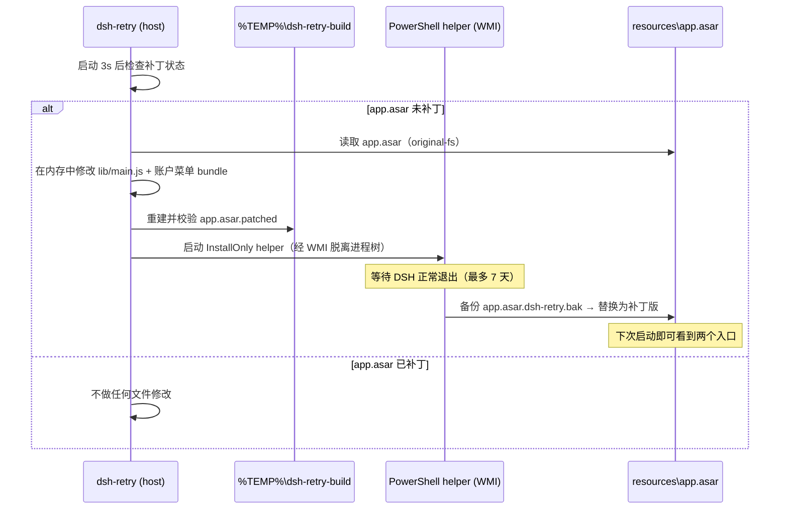

# dsh-retry

**给 DeepSeek Harness 桌面端加一个真正的「重启」入口 —— 就在托盘菜单和账户菜单里，原生样式、原生位置。**

[](https://github.com/kouzerror/dsh-retry/actions/workflows/ci.yml)
[](https://github.com/kouzerror/dsh-retry/releases)
[](./LICENSE)

> Adds a native *Restart DeepSeek Harness* action to the Windows tray menu and the account menu. No sidebar widgets, no extra buttons — just the two places where this action belongs.

---

## 目录

- [它长什么样](#它长什么样)
- [为什么需要核心补丁](#为什么需要核心补丁)
- [工作原理](#工作原理)
- [安装](#安装)
- [验证安装](#验证安装)
- [排障](#排障)
- [开发](#开发)
- [兼容性与安全](#兼容性与安全)
- [版本与同步](#版本与同步)
- [License](#license)

## 它长什么样

| 入口 | 位置 | 效果 |
| --- | --- | --- |
| 🐳 系统托盘 | 右下角小鲸鱼图标 → 右键菜单 | 与「打开 / 退出 DeepSeek Harness」并列的原生菜单项 |
| 👤 账户菜单 | 左下角头像 → 弹出菜单 | 与「设置 / 意见反馈 / 退出登录」并列的原生菜单项（带刷新图标） |

点击后是**优雅重启**：走 `app.relaunch()`，先正常退出再自动重开，不会硬杀进程、不丢会话。

> 0.2.0 起已移除早期版本的侧栏引导按钮。安装后无需找按钮：正常退出一次 DSH 再重开，两个入口就会出现。

## 为什么需要核心补丁

DeepSeek Harness 桌面端的托盘菜单与账户菜单都硬编码在安装目录的 `resources/app.asar` 里，没有向插件开放的 slot，也没有 quit/restart IPC：

- 托盘菜单：`lib/main.js` 中的 `DesktopTray`
- 账户菜单：`dsh/node_modules/@deepseek-ai/dsh-client-ui-settings-account` 中的 `AccountMenu`

所以 dsh-retry 不是“画一个按钮”，而是给这两个原生控件各加一个菜单项。代价也很明确：**DSH 桌面端升级会覆盖 `app.asar`，插件需要在下次启动时重新打补丁**（自动完成，见下）。

## 工作原理



补丁只改两个文件，重建后的 asar 与原始文件除这两个文件外**逐字节一致**（`npm run verify` 会做全量 deep 校验）。

重启路径有两条，都是优雅重启：

- 托盘项：直接执行 `app.relaunch()`；
- 账户菜单项：`POST /dsh-retry/restart` 写入触发文件 `resources/dsh-retry.restart`，主进程内 800ms 轮询到后在原地重启。

## 安装

**方式一：DSH 插件市场**（上架审核中）

**方式二：本地目录 / tarball**

```powershell
# 在 profile 目录安装（推荐，插件管理器同款方式）
cd "$env:USERPROFILE\.dsh\profiles\desktop"
pnpm add file:C:\path\to\dsh-retry
# 或从 Release 下载后安装
pnpm add file:C:\path\to\dsh-retry-0.3.0.tgz

# 然后在 DSH 设置 → 插件中启用 dsh-retry
```

> 用 `file:` 安装时 pnpm 会**复制**目录而不是软链，更新源码后需要重新安装（`remove_bundle` → `install_bundle`）才会生效。

安装完成后：**托盘 → 退出 DeepSeek Harness，再重新打开**。插件会在退出时安装补丁，下次启动后两个入口就位。

## 验证安装

```powershell
# 补丁路由（桌面端 host 端口 = 当前 GUI 端口）
Invoke-RestMethod http://127.0.0.1:<port>/dsh-retry/status | ConvertTo-Json
```

关键字段：

```json
{
  "plugin": { "version": "0.3.0" },
  "desktopVersion": "0.2.1-rc.3",
  "patched": true,
  "mainPatched": true,
  "accountPatched": true,
  "missing": { "main": [], "account": [] }
}
```

`patched: true` 且两个 `missing` 为空，表示两处补丁都已生效。

## 排障

| 现象 | 处理 |
| --- | --- |
| `/dsh-retry/status` 返回 409 `not_desktop` | 当前不是 Windows 桌面端运行环境，插件在此环境不生效 |
| `patched: false`，`missing` 非空 | 正常退出一次 DSH 让 helper 安装补丁；或查看下一条日志确认 helper 是否启动 |
| 退出 DSH 后仍无入口 | 查看 `%TEMP%\dsh-retry-build\restart-helper.log` 与 `restart.log` |
| 补丁后 DSH 升级，入口消失 | 预期行为；新版本首次启动会自动重新准备补丁，退出一次 DSH 后恢复 |
| 想还原原始 asar | 退出 DSH，把 `resources\app.asar.dsh-retry.bak` 改名回 `app.asar` |
| 要彻底卸载 | `pnpm remove dsh-retry`，再按上一条还原 asar（可选） |

诊断顺序：`/dsh-retry/status` → `restart.log` → `restart-helper.log`。

## 开发

```powershell
npm test            # 单元测试（node:test，无需 DSH）
npm run check       # 全部文件语法检查
npm run build       # 生成 %TEMP%\dsh-retry-build\app.asar.patched 并深度校验
npm run verify      # 对比原始 asar 与补丁版：条目/逐字节差异/语法/哈希
```

目录：

```
lib/asar.js        最小 asar 读写器（Electron 下用 original-fs 绕过 asar 虚拟层）
lib/patch.js       托盘菜单 / 账户菜单 / 重启监听三处补丁（逐项幂等、锚点唯一断言）
lib/desktop.js     桌面端路径解析（exe、resources、staging、备份）
lib/helper.js      PowerShell helper 参数构造与拉起
lib/log.js         append-only 日志与尾部读取
lib/index.js       host 插件：status / prepare / restart 路由 + 启动时 arm
scripts/restart-helper.ps1  退出后替换 asar（WMI 脱离进程树；可选重启/仅安装）
test/              node:test 测试（asar 读写、补丁幂等、路径/参数构造、status payload）
```

设计要点：

- **幂等**：每个补丁点都有独立 marker，已补丁的 asar 再跑补丁是 no-op；旧版本打过的半补丁能被新版本补齐而不重复插入。
- **失败要响**：锚点找不到或重复时直接抛错，绝不写出半补丁；重建后强制深度校验。
- **不在运行时改文件**：`app.asar` 只在 DSH 退出后由 helper 替换，避免破坏运行中的进程。
- **可诊断**：所有状态和失败原因都能从 `/dsh-retry/status` 与两个日志文件里读到。

## 兼容性与安全

- 仅 **Windows 桌面端**（依赖 `DeepSeek Harness.exe` + `resources/app.asar` 布局）；Web 端返回 `409 not_desktop`。
- 兼容 DSH `>=0.2.0-rc.1 <0.3.0-0`（见 `dsh.compatibility`）；DSH 内部结构变化导致锚点漂移时，插件会明确报错而不是静默失败。
- 只修改 `resources/app.asar` 的副本，替换前自动备份为 `app.asar.dsh-retry.bak`；不修改 profile、不联网、不收集数据。
- Helper 以当前用户权限运行；替换失败会自动保留备份并回退启动原程序。

## 版本与同步

每次插件更新都会：提交并推送代码 → 打 tag → 发布 GitHub Release（`dsh-retry-<version>.tgz`）。

- 仓库：https://github.com/kouzerror/dsh-retry
- Releases：https://github.com/kouzerror/dsh-retry/releases
- 问题反馈：https://github.com/kouzerror/dsh-retry/issues

## License

[MIT](./LICENSE) © kouzerror
